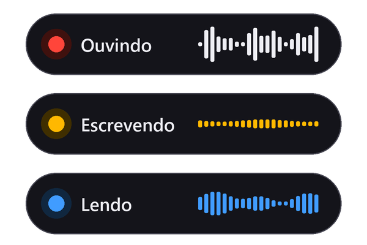
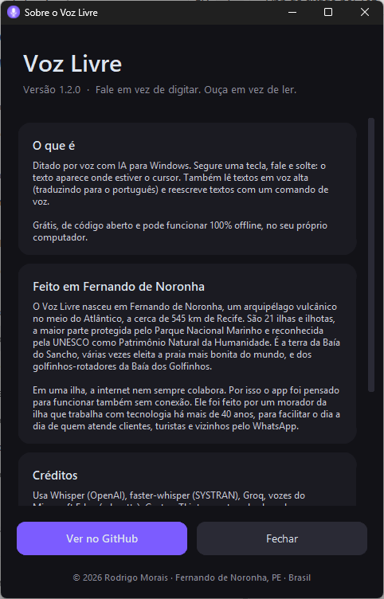
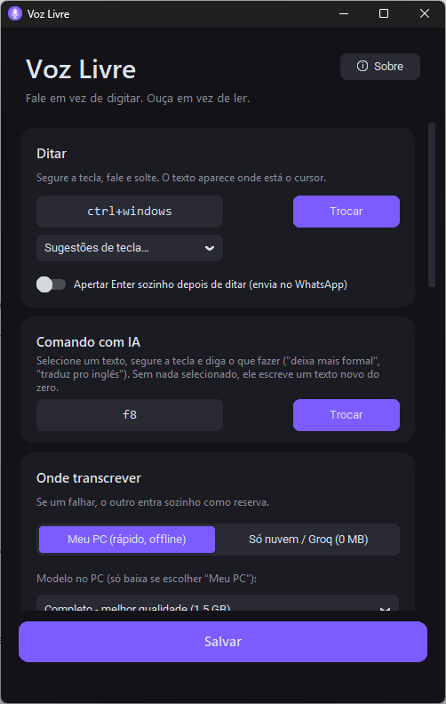

<div align="center">

# 🎙️ Voz Livre

**Fale em vez de digitar. Ouça em vez de ler.**

Ditado por voz com IA para Windows: segure uma tecla, fale e solte. O texto aparece onde estiver o cursor, em qualquer programa.
Grátis, código aberto e pode rodar 100% no seu PC.




*[English summary below](#-english-summary)*

</div>

---

## ✨ O que ele faz

| Recurso | Como usar |
|---|---|
| 🎤 **Ditado** | Segure **Ctrl + Win**, fale e solte. O texto é colado onde está o cursor (WhatsApp, e-mail, Word, navegador...). |
| 🤖 **Comando com IA** | Selecione um texto, segure **F8** e diga o que fazer: *"deixa mais formal"*, *"traduz pro inglês"*, *"resume"*. Sem nada selecionado, ele **escreve um texto novo** a partir do seu pedido. |
| 🔊 **Ler em voz alta** | Selecione um texto em qualquer idioma e aperte **Ctrl + Shift + L**. Ele traduz para o português e lê com voz natural. Aperte de novo para parar. |
| 📋 **Histórico** | Os últimos ditados ficam no menu do ícone (clique para copiar). **Ctrl + Alt + V** cola de novo o último. |
| 📖 **Dicionário** | Ensine nomes e termos que ele deve escrever certo. Dá até para adicionar falando. |
| 🗣️ **Comandos de voz** | *"vírgula"*, *"ponto final"*, *"nova linha"*, *"envia mensagem"* (aperta Enter), *"apaga isso"*... |
| ⚡ **Rápido** | Com placa de vídeo NVIDIA, transcreve 20 segundos de fala em **~0,5 segundo**. |
| 🔒 **Privado** | O ditado pode rodar **100% offline** no seu PC. Nada de assinatura. |

Todas as teclas podem ser trocadas nas Configurações.

---

## 🏝️ Sobre

O **Voz Livre** nasceu em **Fernando de Noronha**, um arquipélago vulcânico no meio do Oceano Atlântico, a cerca de 545 km de Recife. São 21 ilhas e ilhotas, a maior parte protegida pelo **Parque Nacional Marinho** e reconhecida pela **UNESCO como Patrimônio Natural da Humanidade**. É a terra da **Baía do Sancho**, várias vezes eleita a praia mais bonita do mundo, e dos golfinhos-rotadores da Baía dos Golfinhos.

Em uma ilha, a internet nem sempre colabora. Por isso o app foi pensado para **funcionar também sem conexão**, rodando direto no computador. Ele foi criado por **Rodrigo Morais**, morador da ilha que trabalha com tecnologia há mais de 40 anos, para facilitar o dia a dia de quem atende clientes, turistas e vizinhos pelo WhatsApp e não quer pagar assinatura para ditar texto.

A ideia é simples: uma ferramenta boa, gratuita e aberta, feita no Brasil e em português, que qualquer pessoa pode usar, estudar e melhorar.

No app, o "Sobre" fica no ícone perto do relógio → **Sobre o Voz Livre**, ou no botão **ⓘ Sobre** das Configurações.

<div align="center"></div>

---

## 📥 Instalação

### 1. Instale o Python
Baixe o **Python 3.10 ou mais novo** em [python.org/downloads](https://www.python.org/downloads/).
> ⚠️ Na instalação, **marque a opção "Add Python to PATH"**.

### 2. Baixe o Voz Livre
Clique no botão verde **Code → Download ZIP** aqui no GitHub e descompacte numa pasta (ex.: `C:\VozLivre`).
Ou, se você usa Git:
```bash
git clone https://github.com/rodrigoranda/voz-livre.git
```

### 3. Rode o instalador
Dê dois cliques em **`instalar.bat`**. Ele:
- instala as bibliotecas necessárias;
- cria o atalho **Voz Livre** na Área de Trabalho e no Menu Iniciar;
- abre o app.

### 4. Primeira configuração
Na primeira vez, a tela de **Configurações** abre sozinha. Escolha **onde transcrever**:

| Opção | Espaço em disco | Precisa de internet? | Velocidade |
|---|---|---|---|
| **Só nuvem (Groq)** | **0 MB** | Sim | ~1 s |
| **Meu PC - Leve** | ~460 MB | Não | boa com placa de vídeo, ok sem |
| **Meu PC - Completo** (melhor qualidade) | ~1,5 GB | Não | ~0,5 s com placa de vídeo NVIDIA |

> O modelo do PC só é baixado (uma única vez) se você escolher **Meu PC**.

**Chave da Groq (grátis):** necessária para o modo nuvem, para o **Comando com IA** (F8) e para a **tradução** na leitura.
1. Crie uma conta em [console.groq.com](https://console.groq.com) (não pede cartão).
2. Vá em **API Keys → Create API Key**.
3. Cole a chave no campo **"Chave da Groq"** das Configurações e clique em **Salvar**.

Pronto! O ícone 🟣 aparece perto do relógio do Windows.

---

## 🖥️ As telas

<table>
<tr>
<td width="55%">

</td>
<td>

**Configurações**
Abra clicando no ícone perto do relógio → **Configurações** (ou clicando de novo no atalho da Área de Trabalho).

Lá você troca as teclas, escolhe o modelo, a voz da leitura, cola a chave da Groq, liga o "iniciar com o Windows" e mais.

**Pílula flutuante**
Aparece enquanto ele trabalha, sem roubar o foco da janela em que você está digitando. Tem bordas lisas e sombra suave, e é **sua**: arraste para onde quiser com o mouse e ajuste **tamanho** e **opacidade** em Configurações → *Pílula flutuante* (as mudanças aparecem na hora). Para posicionar com calma, use o ícone → **Posicionar pílula**.
- 🔴 **Ouvindo**: a onda acompanha sua voz
- 🟡 **Escrevendo**: transcrevendo / pensando
- 🔵 **Lendo**: lendo em voz alta
- 🟣 **Comando**: ouvindo um comando de IA (F8)

**Ícone na bandeja**
Clique com o botão direito para: Configurações, Histórico, Posicionar pílula, Editar dicionário, Iniciar com o Windows, Sair.

</td>
</tr>
</table>

---

## 📖 Manual de uso

### 🎤 Ditado
1. Clique onde quer escrever (por exemplo, a caixa de mensagem do WhatsApp).
2. **Segure Ctrl + Win** e fale normalmente.
3. **Solte**. O texto aparece em menos de um segundo, já com pontuação.

> Ele grava um pedacinho de áudio *antes* de você apertar a tecla, então pode começar a falar junto com o aperto que a primeira palavra não se perde.

### 🗣️ Comandos de voz (durante o ditado)
| Fale | Resultado |
|---|---|
| "vírgula" | `,` |
| "ponto final" | `.` |
| "ponto de interrogação" / "ponto de exclamação" | `?` / `!` |
| "dois pontos" | `:` |
| "nova linha" / "pula linha" | quebra de linha |
| "novo parágrafo" | linha em branco |
| "... **envia mensagem**" (no final) | cola e aperta **Enter** |
| "**apaga isso**" (sozinho) | apaga o último ditado |

Exemplo: *"Oi Ana vírgula tudo bem ponto de interrogação nova linha chego às três ponto final"* →
```
Oi Ana, tudo bem?
Chego às três.
```

### 🤖 Comando com IA (F8)
- **Reescrever:** selecione um texto, **segure F8** e diga *"deixa mais formal"*, *"corrige os erros"*, *"traduz pro espanhol"*, *"deixa mais curto"*. O texto selecionado é trocado pelo novo.
- **Escrever do zero:** sem nada selecionado, segure F8 e peça: *"escreve uma mensagem educada cobrando o pagamento de novembro"*. O texto pronto é colado no cursor.
- **Dica:** em **Configurações → Sobre você**, conte quem você é e com o que trabalha. A IA passa a escrever no seu contexto.

### 🔊 Ler em voz alta (Ctrl + Shift + L)
Selecione qualquer texto (site, PDF, e-mail) e aperte **Ctrl + Shift + L**. Se estiver em outro idioma, ele traduz para o português antes de ler. Aperte de novo para parar. Dá para escolher entre 3 vozes nas Configurações.

### 📖 Dicionário
Para ele nunca errar nomes de clientes, marcas e termos técnicos:
- **Falando:** segure **F8** e diga *"adiciona no dicionário Fulano"*.
- **Mais garantido:** escreva a palavra certa, **selecione-a**, segure **F8** e diga *"adiciona no dicionário"*.
- **Na mão:** ícone → **Editar dicionário**. O arquivo aceita palavras soltas e correções:
  ```
  NomeDoCliente
  zap zap => WhatsApp
  ```

### 📋 Histórico
Ícone → **Histórico** mostra os últimos 10 ditados (clique para copiar). **Ctrl + Alt + V** cola o último de novo, útil quando o cursor estava no lugar errado.

---

## 🔒 Privacidade: o que sai do seu PC

| Função | Onde roda |
|---|---|
| Ditado no modo **Meu PC** | **No seu computador** (offline) |
| Ditado no modo **Só nuvem** | Áudio enviado à [Groq](https://groq.com) |
| Comando com IA (F8) e tradução | Texto enviado à Groq |
| Voz da leitura | Texto enviado ao serviço de voz do Microsoft Edge |

O histórico, o dicionário, a chave e as configurações ficam **só na pasta do app**, no seu computador. Eles estão no `.gitignore` e nunca vão para o GitHub.

---

## 🛠️ Problemas comuns

| Problema | Solução |
|---|---|
| Não acontece nada ao segurar a tecla | Veja se o ícone está **roxo** (pronto). Cinza = ainda carregando o modelo. |
| A primeira abertura demora | No modo **Meu PC**, o modelo é baixado na primeira vez (460 MB ou 1,5 GB). Depois abre em segundos. |
| "Comando com IA" ou tradução não funcionam | Falta a **chave da Groq** nas Configurações. |
| O texto não aparece em algum programa | Alguns programas rodando como administrador bloqueiam colar. Use **Ctrl + Alt + V** ou o Histórico. |
| Antivírus reclamou | O app observa as teclas para saber quando você segura o atalho (ele não registra o que você digita). Você pode conferir todo o código aqui. |
| Quero ver o que aconteceu | Ícone → **Abrir pasta** → arquivo `voz_livre.log`. |

---

## 📁 Arquivos do projeto

```
voz-livre/
├── voz_livre.py        # o app (bandeja, teclas, gravação, transcrição, IA, leitura, pílula)
├── config_ui.py        # tela de Configurações
├── sobre.py            # janela "Sobre"
├── criar_atalhos.py    # cria os atalhos (usado pelo instalador)
├── instalar.bat        # instalador em um clique
├── requirements.txt    # bibliotecas necessárias
├── .env.example        # exemplo de onde fica a chave da Groq
└── assets/             # imagens do README
```

---

## 🙏 Créditos

O Voz Livre só existe graças a estes projetos e serviços:

**Reconhecimento de voz**
- [Whisper](https://github.com/openai/whisper) da **OpenAI**, o modelo que transforma voz em texto (MIT)
- [faster-whisper](https://github.com/SYSTRAN/faster-whisper) da **SYSTRAN**, que roda o Whisper rápido no PC (MIT)
- [CTranslate2](https://github.com/OpenNMT/CTranslate2) do **OpenNMT**, o motor por trás do faster-whisper (MIT)
- [Mobius Labs](https://huggingface.co/mobiuslabsgmbh/faster-whisper-large-v3-turbo), versão convertida do modelo *large-v3-turbo*

**Serviços**
- [Groq](https://groq.com): Whisper na nuvem e IA (modelos *gpt-oss* da OpenAI) para comandos e tradução
- Vozes neurais do **Microsoft Edge**, via [edge-tts](https://github.com/rany2/edge-tts) de **rany2** (LGPL-3.0)

**Bibliotecas**
- [CustomTkinter](https://github.com/TomSchimansky/CustomTkinter) de **Tom Schimansky**: o visual moderno das telas (MIT)
- [pystray](https://github.com/moses-palmer/pystray) de **Moses Palmér**: ícone na bandeja (LGPL-3.0)
- [keyboard](https://github.com/boppreh/keyboard) de **BoppreH**: teclas de atalho globais (MIT)
- [python-sounddevice](https://github.com/spatialaudio/python-sounddevice) de **Matthias Geier**: gravação do microfone (MIT)
- [pyperclip](https://github.com/asweigart/pyperclip) de **Al Sweigart**: área de transferência (BSD)
- [Pillow](https://github.com/python-pillow/Pillow) (HPND), [NumPy](https://numpy.org) (BSD) e [Requests](https://github.com/psf/requests) (Apache-2.0)

**Inspiração**
- [Wispr Flow](https://wisprflow.ai): o app comercial que inspirou a ideia de "segurar, falar e soltar"
- [Scribe](https://github.com/avibrahms/scribe), [Whisper Local](https://github.com/drajb/whisper-local) e [OpenWhispr](https://github.com/HeroTools/open-wispr): projetos abertos que inspiraram o histórico, o dicionário, a pré-gravação e os comandos de voz

As bibliotecas são instaladas pelo `pip` e não estão copiadas neste repositório. Cada uma segue a sua própria licença.

> **Aviso:** o Voz Livre é um projeto independente. Ele **não é afiliado, patrocinado nem endossado** pela Wispr, OpenAI, Groq ou Microsoft. Nenhum código, marca ou design desses produtos foi copiado. Os nomes aparecem aqui só como referência e crédito. Ao usar a Groq e as vozes do Edge, você também aceita os termos de uso desses serviços.

Desenvolvido por **Rodrigo Morais**, em Fernando de Noronha 🏝️, com a ajuda do [Claude](https://claude.ai) (Anthropic).

---

## 📄 Licença

[MIT](LICENSE): use, modifique e distribua à vontade, inclusive em projetos comerciais. Só mantenha o aviso de copyright.

---

## 🌎 English summary

**Voz Livre** ("Free Voice") is a free, open-source **hold-to-talk voice dictation app for Windows**, focused on Brazilian Portuguese. Independent project, not affiliated with any commercial dictation product.

- **Hold Ctrl+Win, speak, release**: the text is pasted wherever your cursor is.
- **Runs locally** with [faster-whisper](https://github.com/SYSTRAN/faster-whisper) (Whisper large-v3-turbo, ~0.5 s for 20 s of speech on an NVIDIA GPU), or in the cloud via [Groq](https://groq.com) (0 MB download). Each one falls back to the other.
- **AI command (F8)**: select text and say what to do ("make it formal", "translate to English"), or generate new text from a spoken request.
- **Read aloud (Ctrl+Shift+L)**: translates the selected text to Portuguese and reads it with Microsoft Edge neural voices.
- Spoken punctuation, "send message" (presses Enter), "delete that", custom dictionary, history, pre-roll buffer so the first word isn't cut, modern settings window.
- Floating overlay drawn with real per-pixel transparency (smooth edges, soft shadow): draggable, with adjustable size and opacity.

**Install:** Python 3.10+, then run `instalar.bat`. Get a free Groq key at [console.groq.com](https://console.groq.com) for the cloud and AI features. The UI is in Portuguese; dictation language is currently fixed to Portuguese (PRs welcome!).

**About:** made in **Fernando de Noronha**, a volcanic archipelago and UNESCO World Heritage Site off the coast of Brazil, by a local who has worked with technology on the island for over 40 years. Island internet is unreliable, which is why Voz Livre can run fully offline.

License: MIT.
